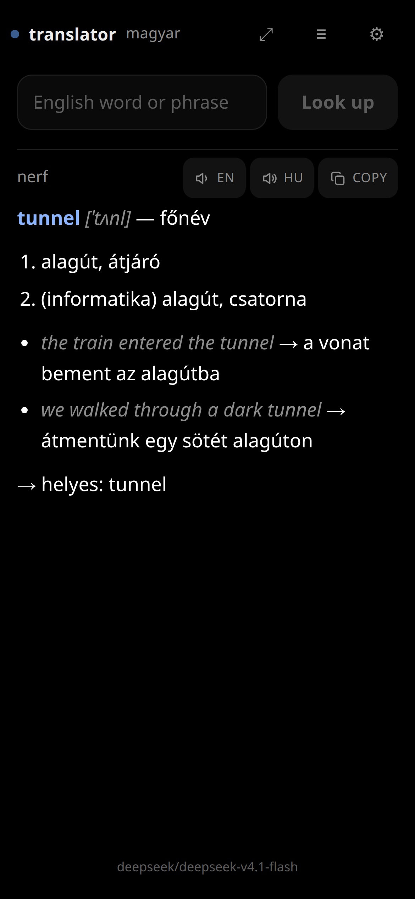
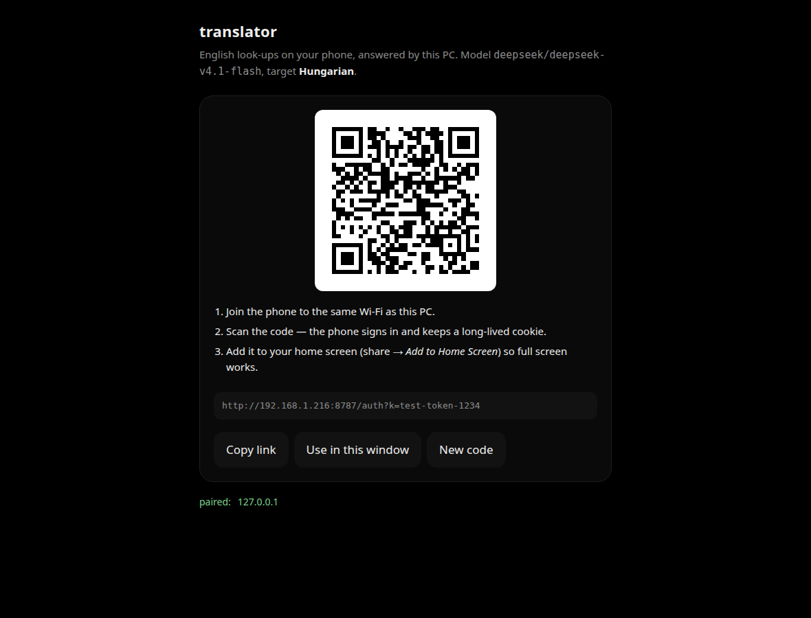
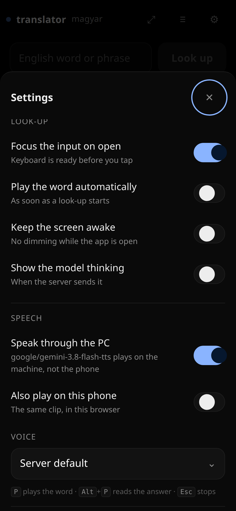
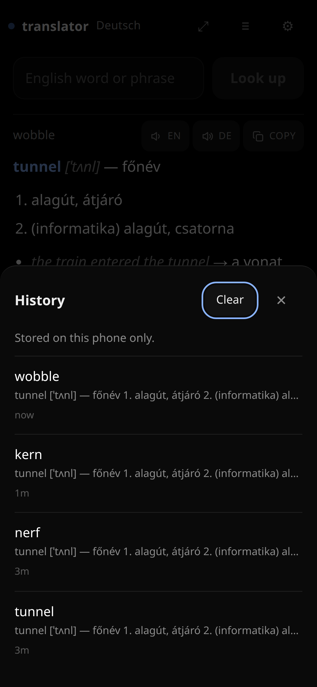

# translator

A pocket English dictionary served from your own PC.

You run it on the desktop, point your phone at the QR code it prints, and from then on the phone is
a full-screen, pitch-black look-up window: type a word or phrase, get a plain-English definition,
the Hungarian meanings — with pronunciation, senses and examples — streamed back word by word from
OpenRouter.

Press play and the answer is spoken **on the PC**, not on the phone, so a look-up is heard in the
headphones you are already wearing mid-game.

Built for the dark: the phone UI is pure `#000` with dimmed secondary text, so glancing at it next to
your keyboard while gaming does not blind you.



| Pairing on the PC | Speech settings | History |
| --- | --- | --- |
|  |  |  |

- **Stack** — Vue 3 + Reka UI + Vite on the front, a small Express server on the back.
- **Model** — `deepseek/deepseek-v4.1-flash` by default, any OpenRouter model id works.
- **Speech** — `google/gemini-3.8-flash-tts` through OpenRouter's `/audio/speech`, played on the PC.
- **Auth** — the QR code carries a one-time link that swaps the shared token for a long-lived cookie.
- **PWA** — installable, works as a standalone/full-screen app, opens offline.

## How it works

```
 phone (PWA)                 your PC                     OpenRouter
 ┌──────────┐   HTTPS/HTTP  ┌────────────────┐  HTTPS   ┌──────────┐
 │ lookup   │──────────────▶│ express server │─────────▶│ chat API │
 │ UI (Vue) │◀── SSE ───────│  + token auth  │◀── SSE ──│          │
 └──────────┘   same Wi-Fi  └────────────────┘          └──────────┘
       ▲                          │
       └──── QR pairing ──────────┘
```

The API key never leaves the PC: the phone only ever talks to your own server.

## Requirements

- Node.js 20.19+ (24 or 22 recommended)
- An [OpenRouter](https://openrouter.ai/keys) API key
- Your phone and the PC on the same Wi-Fi network

## Quick start

```bash
git clone https://github.com/mondalaci/translator.git
cd translator
npm install
npm run build
npm start
```

The first start writes `config.json` next to `package.json` and prints something like:

```
  translator is running
  pc      http://localhost:8787
  phone   http://192.168.1.216:8787
  model   deepseek/deepseek-v4.1-flash
  target  Hungarian (magyar)
  config  /home/you/translator/config.json
  pair    http://192.168.1.216:8787/auth?k=A5f…-token…
```

Put your OpenRouter key into `config.json` → `openrouter.apiKey`, restart, then open
`http://localhost:8787` on the PC. That page shows the QR code — it is only served to `localhost`,
so no other machine on the network can read your pairing token.

Alternatively skip the file and export `OPENROUTER_API_KEY=sk-or-…` before `npm start`.

## Pairing the phone

1. Open `http://localhost:8787` on the PC. A QR code appears.
2. Scan it with the phone's camera. The phone opens `http://<pc-ip>:8787/auth?k=<token>`, the server
   trades the token for a signed cookie and redirects to the app. One tap, nothing to type.
3. Add it to the home screen (share sheet → *Add to Home Screen*) so it launches full screen with
   the app icon. From then on it is a normal app that keeps working until you unpair it.

`New code` on the pairing page rotates the token: every old link and session dies immediately. The
phone's `Settings → Unpair this phone` clears its own cookie.

## Configuration (`config.json`)

| Key | Default | Meaning |
| --- | --- | --- |
| `server.port` | `8787` | Port to listen on. |
| `server.host` | `0.0.0.0` | Bind address. `0.0.0.0` is what makes it reachable from the phone. |
| `server.publicUrl` | `""` | Overrides the host in the pairing link, e.g. a tailscale name. Auto-detected when empty. |
| `openrouter.apiKey` | `""` | Your key. Env: `OPENROUTER_API_KEY`. |
| `openrouter.model` | `deepseek/deepseek-v4.1-flash` | Any OpenRouter model id. |
| `openrouter.temperature` | `0.2` | Low keeps look-ups factual and repeatable. |
| `openrouter.maxTokens` | `700` | Answers are meant to be short. |
| `openrouter.reasoning` | `{ effort: "low", exclude: true }` | Dictionary work needs no thinking budget; set `exclude: false` to stream it to the app. |
| `language.targetName` / `nativeName` | `Hungarian` / `magyar` | Default target; the phone can pick another in Settings. |
| `auth.token` | generated | Shared secret. Generated on first start. Env: `TRANSLATOR_TOKEN`. |
| `auth.sessionDays` | `365` | How long a paired phone stays signed in. |
| `auth.allowRemotePairing` | `false` | Let non-localhost visitors see the pairing QR. Off for a reason. |
| `tts.enabled` | `true` | Master switch for speech. |
| `tts.model` | `google/gemini-3.8-flash-tts` | Any speech model on OpenRouter's `/audio/speech`. |
| `tts.voice` | `Kore` | Prebuilt Gemini voice (30 of them, listed in the app's Settings). |
| `tts.instructions` | `""` | Optional delivery direction, e.g. `calm and clear, slightly slow`. |
| `tts.pcm` | `24000` / `1` / `16` | Format of the returned PCM; only change it for a non-Gemini model. |
| `tts.playOnHost` | `true` | Play the clip through the PC's default audio sink. |
| `tts.player` | `""` | Force a player instead of auto-detecting one. |
| `tts.cache` | `true` | Reuse `.cache/tts/` clips keyed by text, voice and instructions. |
| `rateLimit.lookupsPerMinute` | `30` | Per-IP guard against runaway loops burning credits. Speech shares this budget. |

Env overrides: `PORT`, `HOST`, `OPENROUTER_API_KEY`, `OPENROUTER_MODEL`, `OPENROUTER_BASE_URL`,
`TRANSLATOR_TOKEN`, `TRANSLATOR_PUBLIC_URL`, `TRANSLATOR_CONFIG`.

## Speech: play it on the PC

The play button (and its shortcut) does not use the phone's built-in voice. The phone asks the
server, the server synthesises the text with `google/gemini-3.8-flash-tts` through OpenRouter's
OpenAI-compatible `/audio/speech` endpoint, and then plays the clip **on the machine running the
server** — the desktop with the headset on it. That is the point: you look a word up on the phone
and hear it in the game's audio.

| Action | How |
| --- | --- |
| Play the English word | the `PLAY` button, or `P` |
| Read the answer aloud | the target-language chip, or `Alt`+`P`, or `Alt`+`Shift`+`P` |
| Stop | press it again, or `Esc` |

`P` works whenever the caret is not in the input — which is the usual state right after a look-up,
because submitting blurs the box. The modified shortcuts work even while you type, so nothing steals
a `p` from a word like *happy*.

On the phone side: **Settings → Speech** switches PC playback on or off, picks one of Gemini's 30
prebuilt voices, and can mirror the clip to the phone's own speaker (*Also play on this phone*) for
when you are away from the desk. If the server has no player, the app falls back to the phone's
speech synthesis instead of going silent.

The server picks a player automatically — `paplay`, `pw-play`, `ffplay`, `mpv` or `aplay`, in that
order — and plays through whatever your default sink is. Set `tts.player` to force one.

Gemini TTS returns headerless PCM, so the server wraps it in a WAV header and caches the result under
`.cache/tts/`, keyed by the text, voice and instructions. Pressing play twice on the same word costs
nothing the second time.


## Reachable as `translator.localhost`

If you run nginx for `*.localhost` vhosts, `deploy/nginx-translator.localhost.conf` gives the app a
desktop alias on port 80:

```bash
sudo cp deploy/nginx-translator.localhost.conf /etc/nginx/sites-enabled/
sudo nginx -t && sudo systemctl reload nginx
# then: http://translator.localhost
```

Two details in that vhost are load-bearing: `proxy_buffering off` (look-ups stream token by token,
and a buffering proxy would hold the whole answer back) and `allow 127.0.0.1; deny all;` — proxied
requests look like they come from loopback, so without the ACL any machine on the LAN could reach
the pairing page through nginx and read the token. The QR keeps pointing at
`http://<lan-ip>:8787`, because phones cannot resolve `.localhost`.

## On the phone

- **Look up** — type, hit the keyboard's search key or `Look up`. `Enter` submits, `Shift+Enter`
  makes a newline, `Escape` stops a running request. The answer streams in as the model writes.
- **Full screen** — the ⤢ button uses the Fullscreen API. On iOS Safari that API does not exist for
  installed web apps, so the button tells you to install it instead; once installed, the manifest
  launches it in `standalone`/`fullscreen` display mode.
- **History** — the ☰ button lists the last 60 look-ups (stored on the phone only) and reopens any
  of them instantly without spending tokens.
- **Read aloud** — the `PLAY` chip pronounces the English word, the target-language chip reads the
  answer; both go through the PC (see *Speech* above). Controlled from **Settings → Speech**.
- **Keep the screen awake** — optional Screen Wake Lock, so the phone does not dim while it lies
  next to the keyboard.
- **Target language** — switch in Settings; it applies to the next look-up only, no restart.

## Run it always

```bash
pm2 start ecosystem.config.cjs   # then: pm2 save
```

`pm2 save` matters: the saved list is what `pm2 resurrect` replays on boot through the
`pm2-<user>.service` systemd unit. Without it the app comes back as a 502 on the next reboot.

`npm start` (or `pm2 start npm --name translator -- start`) is the plain foreground variant; `Ctrl+C`
stops it, and a browser hitting `translator.localhost` then gets a 502, because nginx is proxying to a
port nothing is listening on. `config.json` and `dist/` are git-ignored, so rebuilding never touches
your secrets.

## Development

```bash
npm run dev        # vite on :5180 (proxies /api to :8787) + the server on :8787
npm run build      # type-check the SPA and the server, then build dist/
npm start          # serve dist/ and the API from one process
npm run typecheck  # vue-tsc + tsc, no output
```

Use `npm run build && npm start` when you want to try it on the phone — the dev server binds to
localhost, so the phone cannot reach it without extra fiddling.

```
src/                 Vue app (phone UI, pairing screen)
src/lib/             markdown, settings, history, speech, wake lock, display mode
server/              Express: config, auth, OpenRouter streaming, prompt
public/              PWA manifest, service worker, icons
design/              icon master
```

## Security notes

- The API key lives only in `config.json` on the PC; the phone talks to your server, never to
  OpenRouter.
- The pairing QR is served to loopback requests only. `auth.allowRemotePairing: true` lifts that,
  which means anyone on the LAN who opens the page can read the token — leave it off.
- Sessions are an HMAC of the token, so the cookie never carries the secret itself; rotating the
  token invalidates every session at once.
- Traffic inside your LAN is plain HTTP. For untrusted networks, put it behind a TLS reverse proxy,
  or keep `server.host` on `127.0.0.1` and reach it through an SSH tunnel.

## Troubleshooting

| Symptom | Fix |
| --- | --- |
| `502` from `translator.localhost` | The app is not running — nginx is proxying to a dead port. `pm2 start ecosystem.config.cjs && pm2 save`, or `npm start`. |
| Phone cannot connect | Phone and PC on the same Wi-Fi? Some routers have "AP isolation" on, which blocks device-to-device traffic. |
| `401 Not paired` | Scan the QR again, or use `New code` and rescan. |
| `No OpenRouter API key` | Set `openrouter.apiKey` in `config.json` and restart. |
| Look-up fails with a model error | Check the id against [openrouter.ai/models](https://openrouter.ai/models); `~` aliases and `:batch` variants also work. |
| Nothing is heard on the PC | `tts.playOnHost` off, or no player installed. `paplay`, `pw-play`, `ffplay`, `mpv` and `aplay` all work; Settings says which one was found. |
| Speech errors with a 400 about formats | Gemini TTS only returns `pcm`. If you point `tts.model` at another provider, adjust `tts.pcm` (or the `response_format`) to match. |
| The play button does nothing | The answer is still streaming, or the input is focused — click the textarea away and press `P`, or use the button. |
| Cameras will not scan the QR | Raise screen brightness, or copy the link and paste it into the phone's browser. |

## License

MIT — see [LICENSE](LICENSE).
